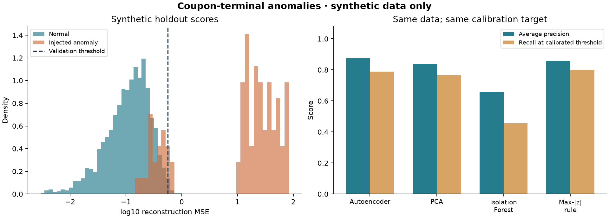

# Coupon Anomaly Autoencoder

**Портфолио Junior ML: обучаемый автоэнкодер для поиска аномалий в синтетических логах терминалов выдачи талонов.**

Python · NumPy · scikit-learn · Matplotlib · SQL-контекст · тесты · GitHub Actions



## Задача

По агрегатам активности сотрудника за день находить необычные комбинации событий: массовую печать, повторное использование, активность вне рабочего времени и несоответствие количества талонов обслуженным клиентам. Результат — очередь записей для проверки, а не доказательство нарушения сотрудником.

Бизнес-мотивация связана с моим опытом проработки антифрод-задачи в системе учёта клиентов. **Этот репозиторий — отдельная личная демонстрация, созданная в октябре 2026 с AI-помощью.** Данные полностью сгенерированы; код и результаты не являются внедрением в банке. Моя самостоятельная ML-практика началась раньше, в ноябре 2025; история этого репозитория начинается с его фактического создания.

## Что реализовано

- Генератор 7 200 синтетических записей: 60 сотрудников × 120 условных дней, 12 признаков.
- Временное разделение до преобразований: обучение — дни 0–59, калибровка — 60–89, проверка — 90–119. Одни и те же синтетические сотрудники встречаются во всех периодах.
- `log1p` для счётчиков и длительностей; `StandardScaler` обучается только на тренировочном периоде.
- Настоящее обучение полносвязного автоэнкодера **12 → 24 → 6 → 24 → 12** через `MLPRegressor.fit(X, X)`. Скрытая активация — `tanh`, выход — линейный, оптимизатор — Adam.
- Оценка аномальности — средняя квадратичная ошибка восстановления стандартизированных признаков. Порог — 99-й процентиль ошибок на более поздних нормальных данных калибровки.
- Сравнение с PCA, Isolation Forest и простым правилом максимального абсолютного z-score на тех же данных и с тем же целевым бюджетом ложных тревог.
- Average precision, ROC-AUC, precision, recall, F1, FPR и полная confusion matrix; отдельный срез для легитимной высокой нагрузки.
- Экспорт весов в JSON и независимый расчёт оценок на CSV без меток. Сохранённая модель читается без pickle/joblib.
- Проверки временного разделения, недопущения утечки, снижения ошибки обучения, корректности признаков и совпадения сохранённой модели с обученной.

## Запуск

Нужен Python 3.11+. Для воспроизведения опубликованного окружения использован Python 3.12.

```bash
python -m venv .venv
# Windows PowerShell:
.venv\Scripts\Activate.ps1
# Linux/macOS: source .venv/bin/activate
python -m pip install -r requirements-lock.txt
python -m pip install --no-deps -e .

python -m coupon_autoencoder run --output artifacts/local/my-run --seed 42
python -m unittest discover -s tests -v

python -m coupon_autoencoder score \
  --model artifacts/local/my-run/model.json \
  --input artifacts/local/my-run/inference_example.csv \
  --output artifacts/local/my-run/scored.csv
```

Для многострочной команды `score` в PowerShell используйте одну строку или замените `\` на обратную кавычку PowerShell. API-ключи, сервер и GPU не нужны. Команда `run` генерирует все данные локально.

## Где посмотреть результат

- [Результаты эталонного запуска](artifacts/demo/RESULTS.md) — все модели, включая случаи, когда простая модель лучше автоэнкодера.
- [Полные метрики и параметры запуска](artifacts/demo/metrics.json).
- [Очередь 25 записей для проверки](artifacts/demo/review_queue.csv).
- [Кривая ошибки обучения](artifacts/demo/loss_curve.csv).
- [Описание данных и границ эксперимента](docs/DATA_CARD.md).
- [Как разобрать проект перед собеседованием](docs/INTERVIEW_GUIDE_RU.md).

Метрики относятся только к конкретному синтетическому генератору и фиксированному отложенному периоду. Здесь нет проверки на реальных клиентских данных, измерения предотвращённых потерь или доказанной экономической эффективности. Выборку теста не используют для подбора архитектуры или порога; признаки, распределения и сценарии генератора заданы автором заранее. Новый тип аномалий или реальные логи могут дать другой результат.

## Структура

```text
src/coupon_autoencoder/
  data.py          # генератор, схема 12 признаков, CSV, валидация
  model.py         # автоэнкодер, три baseline, порог, JSON inference
  experiment.py    # временной эксперимент, метрики, срезы, артефакты
  cli.py           # run / score
tests/             # проверки методики и сохранённой модели
artifacts/demo/    # фактически выполненный эталонный запуск
docs/              # данные, допущения и разбор для интервью
```

Грубость в аудио и текстах — отдельный кейс из моего прежнего обучения. **Этот репозиторий не содержит распознавания речи или модели тональности.** В нём проверяется табличный антифрод-сценарий по агрегатам событий.

## Методические источники

- [scikit-learn: MLPRegressor](https://scikit-learn.org/stable/modules/generated/sklearn.neural_network.MLPRegressor.html) — архитектура, активации и обучение регрессора на восстановление входа.
- [scikit-learn: Common pitfalls / data leakage](https://scikit-learn.org/stable/common_pitfalls.html#data-leakage) — разделение данных до обучения преобразований.

Реализация и документация подготовлены совместно с AI-ассистентом. Публикация проекта не подтверждает самостоятельное написание каждого фрагмента кода или коммерческий ML-опыт.
